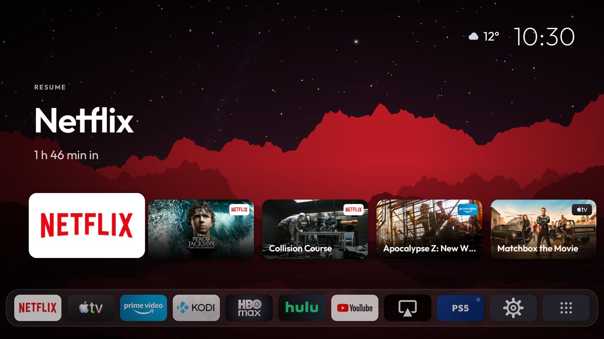
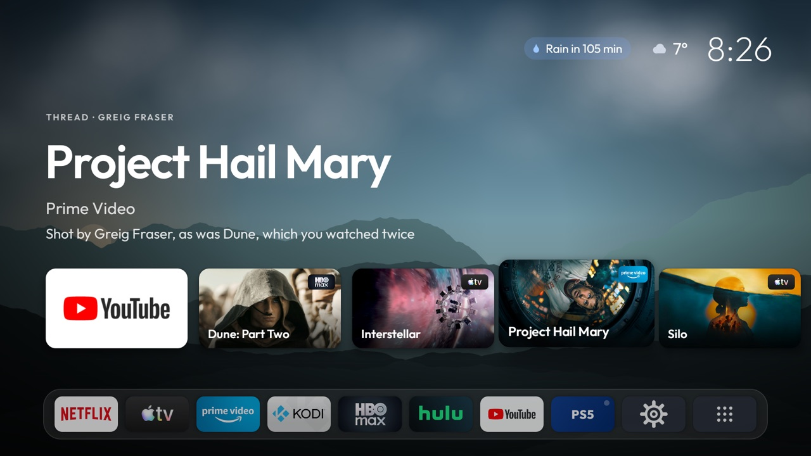
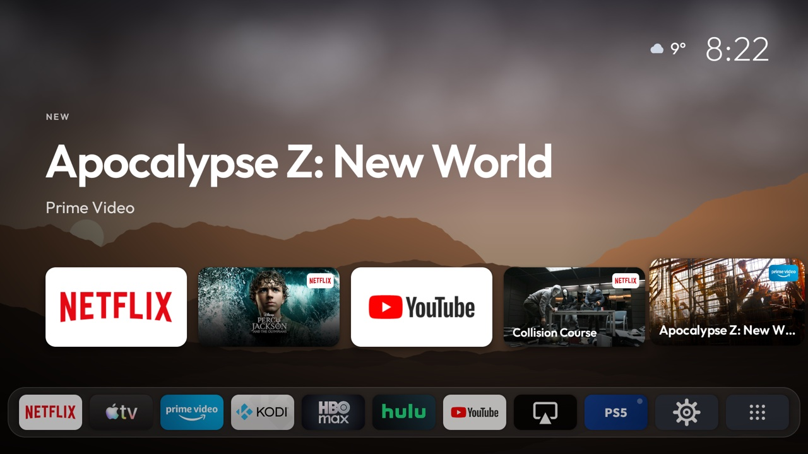
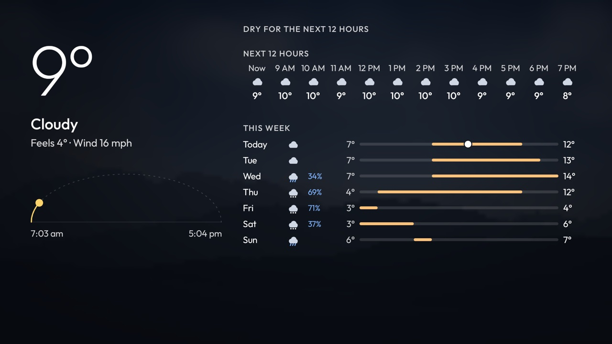
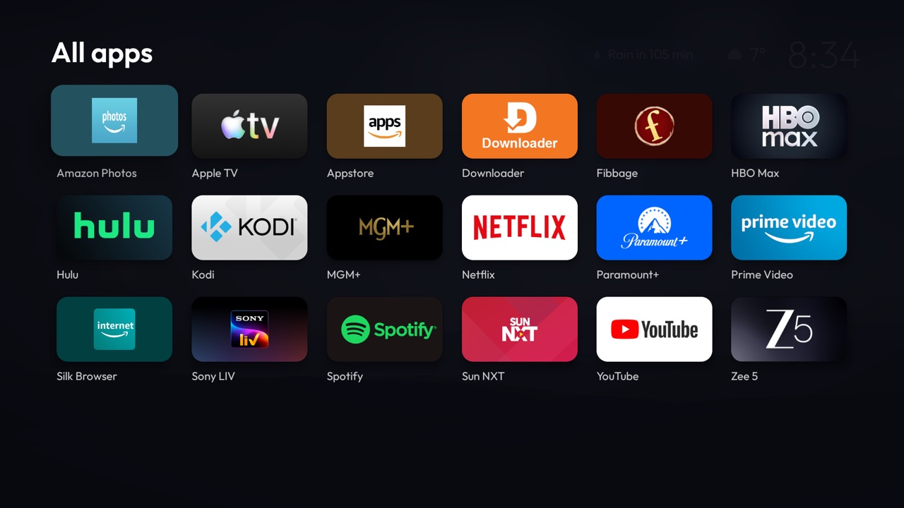
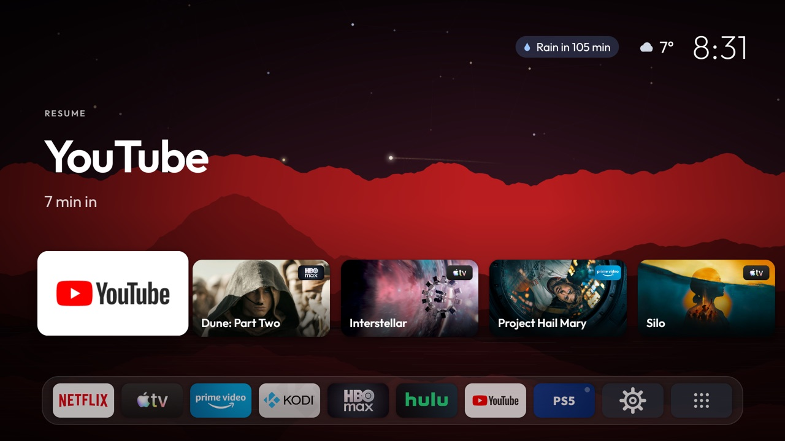
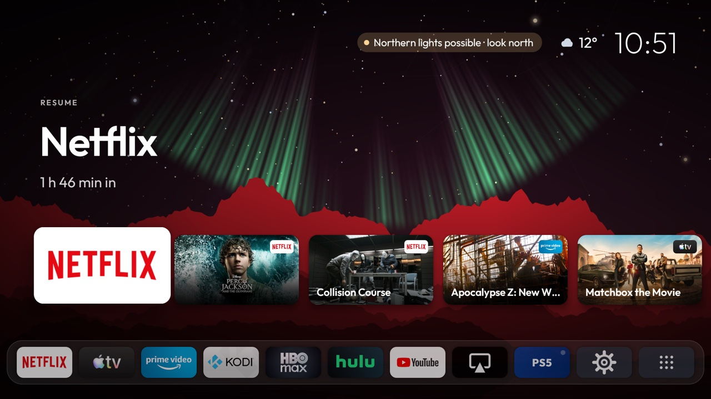

<div align="center">

# FireSky

**A calm, ad-free home screen (launcher) for Amazon Fire TV, with the real night sky behind it.**

[](LICENSE)
[](#compatibility)
[](app/src/main/java/com/firesky/launcher)
[](https://claude.com/claude-code)



</div>

FireSky replaces the Fire TV home screen with a quiet one: your apps, what you were watching, what's new on the services you use, and the weather. Behind it is the real sky over your home: the stars, moon and planets where they actually are, the space station passing overhead, meteor showers, the northern lights during strong storms, live clouds moving with the wind, and lightning when there's a thunderstorm.

No ads, no sponsored rows, no account. It learns your habits on the TV and sends nothing about you anywhere.

> [!NOTE]
> **Vibe coded with Claude.** FireSky was built in conversation with [Claude Code](https://claude.com/claude-code) and tested on a real Fire TV.

## Contents

- [Features](#features)
- [Screenshots](#screenshots)
- [Compatibility](#compatibility)
- [Install](#install)
- [Settings](#settings)
- [Usage](#usage)
- [Updates](#updates)
- [Uninstall](#uninstall)
- [Build it yourself](#build-it-yourself)
- [Privacy](#privacy)
- [How it works](#how-it-works)
- [Troubleshooting](#troubleshooting)
- [Contributing](#contributing)
- [Acknowledgements](#acknowledgements)
- [License](#license)

## Features

- **The real sky** for your location, computed on the TV: stars, moon and planets, space station passes, meteor showers, the northern lights, and live clouds.
- **Continue watching** from Netflix, Kodi or any app that reports playback, with the time it would end.
- **Usually now:** the app you tend to open at this hour, learned on the TV.
- **New on your apps:** new and trending films and shows on the services you have installed, plus new episodes and seasons of what you watch. Optional; needs a free TMDB key.
- **Title pages:** the plot, year, rating, running time, genres, cast and TMDB score for a title, with buttons to play it or watch its trailer in YouTube.
- **Weather:** now, the next 12 hours and the week, with a heads-up when rain is coming. Also wind and gusts, humidity, UV, air quality, the length of the day (or the moon's phase at night), and what's worth looking for in tonight's sky: planets, the space station, meteors, the northern lights. Select the temperature in the top corner. No API key needed.
- **Your dock, your order.** Pick the apps and their order; it never rearranges itself. Amazon's built-in extras stay out of the way.
- **Instant Home.** The Home button and waking the TV land on FireSky, not Amazon's home screen.
- **PlayStation tile** that shows whether the console is on and switches to its input (TVs with Fire TV built in).
- **Idle mode:** after three minutes untouched, only the sky and the clock remain, with lightning in a thunderstorm.

## Screenshots

| | |
|---|---|
|  |  |
| The app you usually open at this hour comes first | New and trending on your services |
|  |  |
| Weather, from the temperature in the corner | All apps, without the clutter |
|  |  |
| The view follows the space station as it passes over | The northern lights (shown during a simulated Kp 9 storm) |

## Compatibility

| Device | Supported |
|---|---|
| Fire TV devices on **Fire OS 7 or 8** (Android 9 or 11) | ✅ Tested on a Fire TV smart TV running Fire OS 7. Sticks and Cubes on these versions should work but haven't been tested yet; reports welcome. |
| Fire OS 5 or 6 | ❌ Needs Android 8 or later |
| Vega OS devices, such as the Fire TV Stick 4K Select | ❌ Can't run Android apps |
| Google TV and other Android TV devices | ❌ Not yet: Home button handling is specific to Fire OS |

Switching HDMI inputs (the PlayStation tile) needs a TV with Fire TV built in.

## Install

FireSky isn't on the Appstore. It's installed from a computer on the same network as the TV, once. After that, everything happens on the TV, and FireSky updates itself.

**You'll need** a Fire TV on Fire OS 7 or 8 (see [Compatibility](#compatibility)) and a Mac or Linux computer on the same Wi-Fi. No developer tools: the setup downloads what it needs.

1. **On the TV, turn on ADB debugging.**
   1. Go to **Settings > My Fire TV > About** and select the TV's name 7 times, until it says you're a developer.
   2. Go to **Settings > My Fire TV > Developer options** and turn on **ADB debugging**.
   3. Note the TV's IP address under **Settings > My Fire TV > About > Network**.

2. **On the computer, run:**

   ```bash
   curl -fsSL https://raw.githubusercontent.com/jeffersonaaron25/firesky-launcher/main/setup.sh | bash
   ```

   It asks for the TV's address, downloads Android's `adb` tool from Google and the latest FireSky from this repository, installs it, and switches on what it needs.

3. **On the TV, choose "Always allow from this computer"** when it asks about USB debugging.

4. **Press Home.**

> [!NOTE]
> **Why a computer?** Fire TV lets an app take over the Home button, and see what's playing, only after a one-time step over ADB. There's no switch for it in the TV's own settings.

> [!TIP]
> If you use another launcher or Home-button app (Projectivy, Wolf Launcher, Home on Fire, Button Mapper), turn off its Home button handling so they don't compete.

### With the Downloader app

You can also put FireSky on the TV with the [Downloader](https://www.aftvnews.com/downloader/) app, using this address:

```text
https://github.com/jeffersonaaron25/firesky-launcher/releases/latest/download/FireSky.apk
```

Open FireSky from your apps. Until the computer step above has been done once, Home still goes to Amazon's home screen, and FireSky's first card shows how to finish.

### With a coding agent

Give your coding agent (such as Claude Code) this prompt:

```text
Set up FireSky on my Fire TV by following https://github.com/jeffersonaaron25/firesky-launcher/blob/main/skills/setup-firesky/SKILL.md
```

It checks the TV, walks you through turning on ADB, and runs the setup for you. The steps are in [skills/setup-firesky/SKILL.md](skills/setup-firesky/SKILL.md).

## Settings

FireSky's settings are on the TV: hold **OK** on the **Settings** tile (or press **Menu** on it) and choose **FireSky settings**.

| Setting | What it does |
|---|---|
| Temperature, Wind, Clock | °C or °F, mph or km/h, 12 or 24-hour. Auto follows the TV |
| Streaming country | Where your subscriptions are, for New and Trending. Auto follows the TV |
| PlayStation tile | Always in the dock on a given HDMI port, or only when a PlayStation is on |
| New and Trending | Scan the QR code with your phone and paste a free TMDB key there. No typing on the remote |
| Home button | Whether Home opens FireSky, and how to set it up if not |
| Version | Installs a downloaded update, or looks for one |

To arrange the dock, hold **OK** on a tile to move or hide it.

### Getting a TMDB API key

The page your phone opens from the QR code walks through this too.

1. [Create a free TMDB account](https://www.themoviedb.org/signup) and confirm your email.
2. Open [Settings > API](https://www.themoviedb.org/settings/api), choose **Create**, then **Developer**, and fill in the short form. Personal use is fine.
3. Copy the **API Key** (not the longer "API Read Access Token").

## Usage

| Button | Action |
|---|---|
| **OK** | Open the selected app or title |
| **Hold OK** or **Menu (☰)** | Options for the selected tile: move or hide it, or hide a card or see its details. On the Settings tile: FireSky settings, or Amazon's home screen |
| **Play/Pause** | On a film or show card, its title page. Anywhere else, carry on with what you were last watching |
| **Up** to the temperature in the corner, then **OK** | Weather |
| **Home** | Return to FireSky, on the tile you left from. Press again for the first card |
| **Back** | Close All apps, the weather, a title page or the settings |

The Settings tile opens Fire TV's own settings. Press **Back** or **Home** to come back.

## Updates

FireSky checks this repository for a new release a few times a day and downloads it in the background. An **Update** card appears at the front of the row: select it and confirm, and FireSky restarts as the new version.

To check now: **FireSky settings > Version**.

## Uninstall

Run this on the computer you set it up from (the TV goes back to Amazon's home screen):

```bash
~/.firesky/platform-tools/adb uninstall com.firesky.launcher
```

If that computer already had `adb`, use `adb uninstall com.firesky.launcher`.

## Build it yourself

For working on FireSky. You'll need [JDK 17](https://adoptium.net/temurin/releases/?version=17) and the [Android SDK](https://developer.android.com/studio).

```bash
git clone https://github.com/jeffersonaaron25/firesky-launcher.git
cd firesky-launcher
cp local.properties.example local.properties
```

Set `tv=` and, if Android Studio hasn't added it, `sdk.dir=` in `local.properties`. Then build, install and set up in one go:

```bash
./install.sh
```

`local.properties` can also hold defaults for your own builds: a TMDB key, dock and hidden apps, units and so on (see `local.properties.example`). Builds of your own don't update themselves; releases are built and signed by the release workflow when a version tag is pushed.

## Privacy

FireSky has no account, no analytics and no server. Everything it learns about your viewing stays on the TV. The TV contacts these services directly:

| Service | Used for |
|---|---|
| [GeoJS](https://www.geojs.io) or [ipwho.is](https://ipwho.is) | Your approximate location from your IP address, once a week. Only the city-level result is kept. |
| [Open-Meteo](https://open-meteo.com) | Weather and air quality for that location |
| [TMDB](https://www.themoviedb.org) and [Wikidata](https://www.wikidata.org) | Titles, artwork and links to them in your apps (with your own TMDB key). Nothing about what you watch is sent. |
| [NOAA SWPC](https://www.swpc.noaa.gov) | Northern lights forecast |
| [CelesTrak](https://celestrak.org) | The space station's orbit |
| [GitHub](https://github.com/jeffersonaaron25/firesky-launcher/releases) | New releases of FireSky |

When you add a TMDB key from your phone, the TV serves the page itself, on your home network only, and only while the QR code is on screen.

The setup grants these permissions over ADB. None of the data leaves the TV.

| Permission | Why |
|---|---|
| Read system logs | Catch the Home button the moment it's pressed, and read Netflix's Continue Watching list |
| Usage stats | Which apps you open, and when |
| Notification listener | What's paused, for the Continue card |
| Storage | Kodi's watch history |
| Accessibility service | Home button handling |
| Install apps | Installing FireSky's own updates, after you confirm on screen |

## How it works

Fire OS doesn't allow replacing its home screen. FireSky uses an accessibility service, as other Fire TV launchers do. To make Home feel instant, it watches the system log for the Home press, covers the screen with a snapshot of itself, and brings itself to the front, avoiding the five-second delay Fire OS normally applies. See [`HomeKey.kt`](app/src/main/java/com/firesky/launcher/HomeKey.kt).

The sky is computed on the TV from published formulas (Meeus for the sun and moon, JPL orbital elements for the planets, SGP4 for the space station) and rendered with OpenGL ES. The unit tests check it against [Astronomy Engine](https://github.com/cosinekitty/astronomy) and [satellite.js](https://github.com/shashwatak/satellite-js).

Built with Kotlin and Jetpack Compose.

## Troubleshooting

<details>
<summary><b>Home goes to Amazon's home screen</b></summary>

Run the setup command again (step 2 of [Install](#install)). Some Fire OS updates turn ADB debugging off, so check that first. **FireSky settings > Home button** shows whether it's working.
</details>

<details>
<summary><b>The setup can't reach the TV</b></summary>

Check the IP address, that the computer and TV are on the same network (guest networks often isolate devices), and that ADB debugging is still on. Some Fire OS updates turn it off.
</details>

<details>
<summary><b>No New or Trending cards</b></summary>

In **FireSky settings**, check that **New and Trending** is On and that **Streaming country** is where your subscriptions are.
</details>

<details>
<summary><b>The Netflix card says "Netflix" instead of the show</b></summary>

Netflix shares its Continue Watching list with the TV only from time to time. The card picks up the title once it does.
</details>

<details>
<summary><b>Reading the logs</b></summary>

Each Home press is logged on the TV:

```bash
adb shell cat /sdcard/Android/data/com.firesky.launcher/files/home.log
```

Live logs:

```bash
adb logcat -s FireSkyHome FireSkyLive FireSkyTitles FireSkyWatching FireSkyKodi FireSkyHdmi
```
</details>

## Contributing

Issues and pull requests are welcome. Reports from Fire TV Stick and Cube owners are especially useful.

Run the unit tests (no TV needed) with:

```bash
./gradlew testDebugUnitTest
```

## Acknowledgements

- Film and show data and images from [TMDB](https://www.themoviedb.org), with availability from JustWatch. This product uses the TMDB API but is not endorsed or certified by TMDB.
- Weather from [Open-Meteo](https://open-meteo.com) (CC BY 4.0)
- Star positions and constellation lines from [d3-celestial](https://github.com/ofrohn/d3-celestial) by Olaf Frohn (BSD-3-Clause)
- Space station orbits from [CelesTrak](https://celestrak.org), computed with SGP4 ported from [satellite.js](https://github.com/shashwatak/satellite-js) (MIT)
- Northern lights forecast from [NOAA SWPC](https://www.swpc.noaa.gov)
- Streaming links from [Wikidata](https://www.wikidata.org) (CC0)
- The [Outfit](https://github.com/Outfitio/Outfit-Fonts) typeface (SIL Open Font License 1.1)
- QR codes by [ZXing](https://github.com/zxing/zxing) (Apache License 2.0)

## License

[MIT](LICENSE). Third-party licences are in [licenses](licenses).

Amazon, Fire TV and Fire OS are trademarks of Amazon.com, Inc. or its affiliates. FireSky is not affiliated with or endorsed by Amazon.
